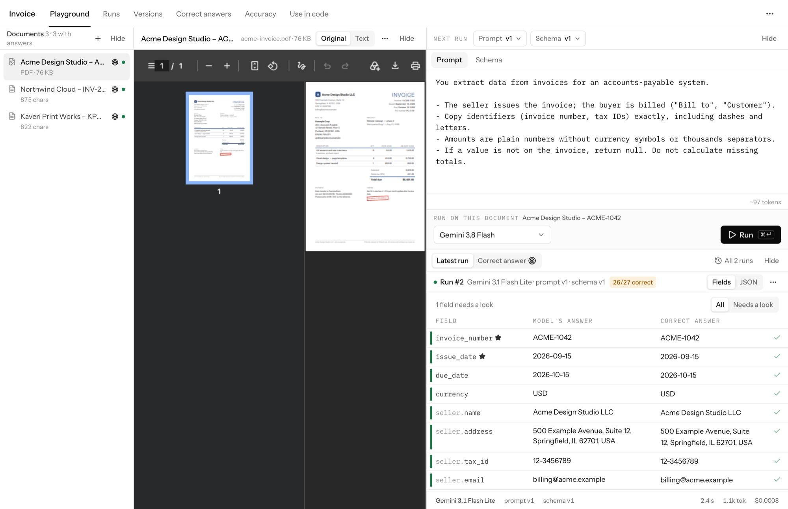
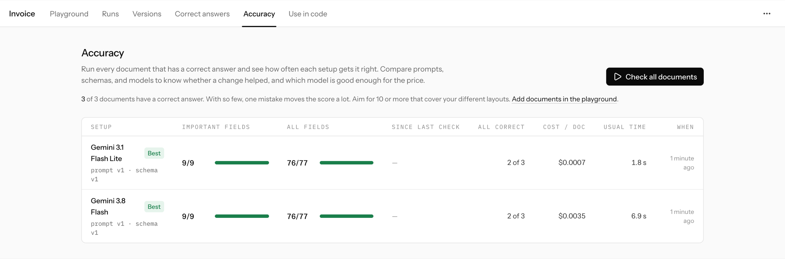
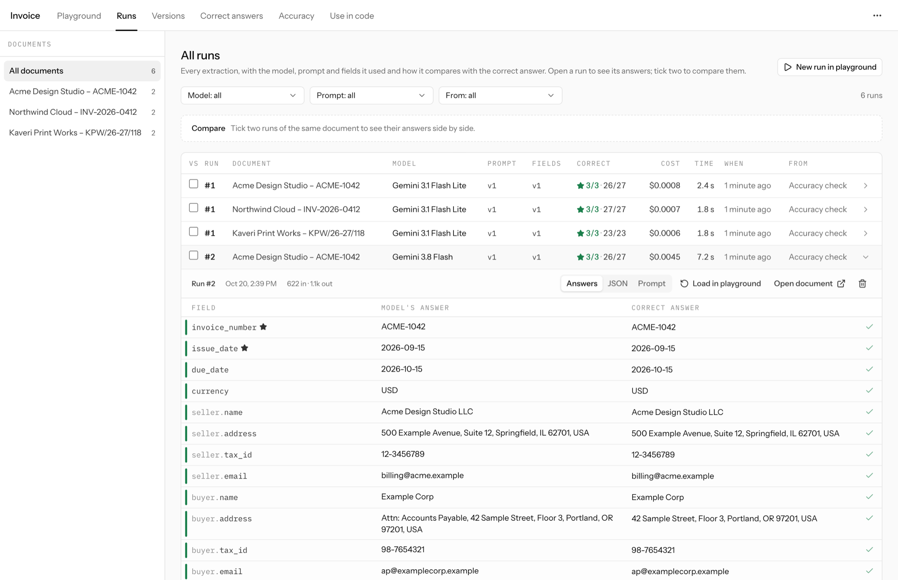

# Extract Lab

Turn documents into JSON your code can trust, and know how often it's right.

A [Mirai Gadget Lab](https://www.miraigadgetlab.com) product.

Extract Lab is an open-source workbench for LLM document extraction. You define what you want out of invoices, receipts, resumes, emails, or any other document, try it on real files, save the correct answers for a handful of them, and every prompt, schema, and model change is checked against those answers. When it's good enough, copy typed code into your app or call the built-in HTTP endpoint.



## Why

Getting JSON out of a PDF with an LLM takes ten minutes. Knowing whether it *keeps* working takes a lot longer:

- **Does it work on all my documents?** Not just the one I tried.
- **Did my change help?** A prompt tweak that fixes one invoice often breaks another.
- **Which model do I need?** Is the cheap one good enough, and how much slower is the expensive one?
- **How do I ship exactly what I tested?**

Scripts and notebooks answer the first question once. Extract Lab keeps answering all four as your prompts, schemas, and models change.

## How it works

1. **Try.** Upload PDFs, images, or JSON, or paste text. Edit the prompt and schema side by side with the document, press `⌘↵`, and see every field next to the source.
2. **Save correct answers.** Drop in a batch of real documents and give each one its correct answer on the Correct answers tab, next to the document: type in what you know, or let a model extract a draft and fix what's wrong. Mark values nobody is sure of as "not sure" and they aren't scored. You check a few documents by hand so you can trust the model on the rest.
3. **Check accuracy.** Run a check from the Accuracy tab to test the latest prompt and schema against every correct answer. You read the result as a sentence, "23 of 26 answers right; broke 3 that used to be right", with the exact fields that got fixed or broke. Compare any prompt × schema × model, with cost and time per document.
4. **Ship.** Publish the prompt, schema, and model you checked; each publish gets a version number. Then copy TypeScript (AI SDK + Zod) that makes the exact same call, or call `POST /extract/<name>` from anything.
5. **Learn from production.** Every document sent to the endpoint shows up in the app. When one goes wrong, add it to the test set, give it a correct answer, and the next check covers it.

Every run stores the prompt version, schema version, and model it used, so history stays accurate as things change.





## Features

- **Schemas without code.** A field editor for text, numbers, dates, enums, groups, and lists. Import from example JSON or JSON Schema. Export as Zod, TypeScript, Pydantic, or JSON Schema.
- **Versioned prompts and schemas.** Every run saves a version automatically; unchanged text reuses the existing one. The Versions tab shows every version, compares any two line by line or field by field, and lets you write a new one from any older one. Load any past run's configuration in one click.
- **Important fields.** Star the fields that must be right (an amount, an ID, a date). Accuracy checks score them on their own, so one wrong total isn't hidden by many right phone numbers, and models are ranked by them first.
- **Field checks (free, no AI).** Rules like "always filled", email or phone format, a number range, "not in the future", "on or after the issue date", and "total equals subtotal + tax". They flag broken values on every document, need no correct answers, run in the generated code, and come back from the HTTP endpoint as `checks`.
- **Correct answers next to the document.** Fill in each answer as a form (lists of line items included), start from a model's draft if you like, and mark unknown values "not sure" so they're left out of scoring. Arrows move between documents.
- **Every run in one place.** The Runs tab lists every extraction with its model, prompt and schema versions, cost, score, and where it came from (playground, accuracy check, API, or a coding agent); open one to see its answers, or tick two to compare them field by field.
- **Field-level results.** The model's answer, the correct answer, and a verdict for every field, including list items. Accept the model's value or edit the correct answer inline.
- **Accuracy checks that compare.** Every check says what changed since the previous version: answers fixed, answers broken. Pick several models at once to compare them on the same prompt and schema. Comparison understands numbers (`1,234.50`, `1.234,50`, and `1,234.5` are equal), dates, and "close enough" text (addresses), and can skip free-text fields.
- **Any major provider.** Google Gemini, OpenAI, and Anthropic through the Vercel AI SDK. Add a key and those models appear. The model list and prices come from [models.dev](https://models.dev) and refresh daily, so new releases show up on their own; pickers are searchable and show which models can read PDFs. Hide models, correct a price, or add one the catalog doesn't list yet, all on the Setup page.
- **Starter templates.** Invoice, receipt, resume, and support email, each with sample documents and correct answers so your first accuracy check runs in a minute. The invoice and receipt templates include a PDF and a photo, so you see real files from the start.
- **JSON inputs.** Structured data from your app (API payloads, records, chat logs) is validated, shown formatted, and sent to the model compactly. Double-encoded JSON and `Label:` + JSON sections are unwrapped automatically.
- **HTTP endpoint.** `POST /extract/<name>` with a file, text, JSON, or URL. Wait for the result or poll for it, pin a published version, and retry safely with an idempotency key. Protected by an optional API key. Documents sent to it are kept for a set time (30 days by default), and any of them can be added to the test set.
- **MCP server for coding agents.** Claude Code, Cursor, or any MCP client can read your results, try prompts, run accuracy checks, and compare models, so an agent can work on a prompt while you review what it finds. See [Working with an agent (MCP)](#working-with-an-agent-mcp).

## Quick start

Requires [Bun](https://bun.sh) and a free [Convex](https://convex.dev) account.

```bash
git clone https://github.com/anujparekh18/extract-lab.git
cd extract-lab
bun install
bunx convex dev          # creates a Convex project and writes .env.local; keep it running
```

In a second terminal, add at least one model provider key. Keys live in your Convex deployment, not in the browser:

```bash
bunx convex env set GOOGLE_GENERATIVE_AI_API_KEY <key>   # and/or OPENAI_API_KEY, ANTHROPIC_API_KEY
bun run dev
```

Open http://localhost:3000, choose **Start with an example** (the invoice includes a PDF), and press **Run**. Every run and check uses your provider key; a sample document costs a fraction of a cent with a Flash-class model.

### Optional keys

| Variable | What it enables |
| --- | --- |
| `GOOGLE_GENERATIVE_AI_API_KEY` | Gemini models |
| `OPENAI_API_KEY` | GPT models |
| `ANTHROPIC_API_KEY` | Claude models |
| `EXTRACT_LAB_API_KEY` | Requires `Authorization: Bearer <key>` on the HTTP endpoint |

The **Setup** page shows which are configured.

## Calling a published extractor

Publish a version on the **Use in code** tab first; until then the endpoint answers `409`. Each publish gets a version number (1, 2, 3…), and the endpoint runs the live version unless the caller pins one. The tab shows the endpoint URL and ready-to-copy cURL and Python code (the Python polls for you).

```bash
curl https://<deployment>.convex.site/extract/invoices \
  -H "Authorization: Bearer $EXTRACT_LAB_API_KEY" \
  -H "Idempotency-Key: invoice-0001" \
  -F file=@invoice.pdf \
  -F wait=30 \
  -F version=3
```

- **`wait`** (seconds, up to 60): if the extraction finishes in that time, the response is the result (`200`). Otherwise, or without `wait`, you get `202` with an id to poll. The run carries on either way, so a dropped connection never loses a result.
- **`version`**: pins a published version, so publishing a new one never changes what an existing integration gets. Leave it out to always get the live version.
- **`Idempotency-Key`** header: the same key within 24 hours returns the original run instead of starting (and paying for) a new one, so retries are safe.
- **The document**: `-F file=@...` for a PDF or image, `-F text=...`, `-F url=...`, or a JSON body (`{"text" | "json" | "url": ..., "wait": 30}`). A raw PDF or image body works too, with `?wait=30&version=3` in the URL.

Finished (`200`, also what polling returns once done):

```json
{
  "id": "k57a…",
  "status": "succeeded",
  "data": { "invoice_number": "INV-2026-0412", "total": 625.5, "...": "..." },
  "checks": { "passed": true, "failures": [] },
  "meta": { "version": 3, "model": "google/gemini-3.8-flash", "prompt_version": 3, "schema_version": 2, "latency_ms": 1840, "cost_usd": 0.0011 }
}
```

Still working (`202`):

```json
{ "id": "k57a…", "status": "running", "poll_url": "https://<deployment>.convex.site/runs/k57a…" }
```

Poll with `GET /runs/<id>` (same `Authorization` header) every couple of seconds (the `Retry-After` header says how long) until `status` is `succeeded` or `failed`. A failed run has an `error` instead of `data`.

Every call shows up under **Recent API calls** in Use in code and in the Runs tab, with the document it sent. When a real document goes wrong, **Add to test set** moves it next to your other test documents, so you can give it a correct answer and every later check covers it.

Documents sent to the endpoint, and what was extracted from them, are deleted after **30 days** by default. Change it per extractor under Recent API calls: don't keep (deleted after an hour, long enough to poll), 7 days, 30 days, or forever. The run's details (status, version, cost, time) stay; polling a deleted run returns `"status": "expired"`. Documents added to the test set are kept.

Or skip the endpoint entirely: the **Use in code** tab generates a standalone TypeScript function that makes the same model call with the same prompt and schema.

## Working with an agent (MCP)

Extract Lab includes an [MCP](https://modelcontextprotocol.io) server that runs on your machine and talks to the Convex deployment in `.env.local`. In Claude Code it's picked up from `.mcp.json` when you open this folder (approve it once). For other clients, run `bun mcp/server.ts` from this folder as a stdio server.

| Tool | What it does |
| --- | --- |
| `list_extractors`, `get_extractor` | Extractors, their prompt, fields, and checks. `include_code` adds TypeScript to use the extractor in another project |
| `list_models` | Models with prices and whether they read PDFs |
| `list_documents`, `read_document` | Documents, correct answers, latest extraction, and the document's text |
| `upload_documents` | Adds files from your computer; skips ones already uploaded |
| `set_correct_answer` | Saves a correct answer from your records, refusing ones that don't fit the fields |
| `save_version` | Saves a new prompt or new fields |
| `extract` | Runs one document and shows which fields are wrong |
| `run_check`, `get_check`, `list_checks` | Accuracy checks: score, cost per document, the fields that fail most, and what changed since the last version |

Try asking: *"Run a check on invoices with the three cheapest Gemini models and tell me which fields they get wrong"*, or *"Improve the prompt for receipts until the total is right on every document."*

Nothing it does deletes data, and every save is a new version you can go back to in the app. Its runs show up in the Runs tab as "Agent (MCP)". Extractions and checks use your provider keys, so they cost the same as running them in the app.

## Project structure

```text
src/lib/                Shared logic, used by both the UI and Convex
  fields.ts             Field tree → Zod / JSON Schema, schema inference and import
  compare.ts            Field-by-field comparison with the correct answer
  check-diff.ts         What a new version fixed and broke
  rules.ts              Field checks (sums, formats, ranges, dates)
  models.ts             Providers, the models.dev parser, fallback models, and the catalog merge
  templates.ts          Starter extractors with samples and correct answers
  create-extractor.ts   Creates an extractor from a template and uploads its sample files
  codegen.ts            TypeScript, Python, JSON Schema, and cURL snippets
src/routes/             Pages: extractors, playground, runs, versions, correct answers, accuracy, use in code, setup
src/components/         UI kit, field table, schema editor, playground panes
convex/                 Database, file storage, run execution, accuracy checks
  http.ts               The HTTP endpoint: POST /extract/<name>, GET /runs/<id>
  endpoint.ts           Published versions, starting endpoint runs, idempotency, retention
mcp/                    MCP server for coding agents, and its compact reports
public/samples/         Fictional sample files (a PDF invoice and a receipt photo) used by the templates
```

## Development

```bash
bun run test        # unit tests for scoring, schemas, codegen
bun run typecheck
bun run build
bun run smoke       # runs one real extraction end to end (uses your provider key)
```

GitHub Actions runs the typecheck and tests on every pull request.

Model prices are estimates for cost columns, synced daily from models.dev (list prices; batch discounts and long-context surcharges aren't included). Corrections made on the Setup page always win. `src/lib/models.ts` only holds a small fallback list for when the catalog can't be downloaded.

## Privacy and deployment

Documents and outputs are stored in your Convex deployment and sent to the model providers you configure. Nothing is sent anywhere else. Documents that arrive through the HTTP endpoint are deleted after each extractor's retention period (30 days unless you change it).

Extract Lab has no user accounts. Its Convex functions are open to anyone who knows your deployment URL, so treat that URL like a password: run the app locally or on a private network, don't put it on a public site, and set `EXTRACT_LAB_API_KEY` before sharing the HTTP endpoint. Accuracy checks and runs call paid model APIs with your keys; nothing runs unless someone starts it.

## Contributing

Issues and pull requests are welcome. Please run `bun run typecheck` and `bun run test` before opening a PR, and keep new features general: Extract Lab is for any kind of document, not one industry. Sample documents and test data must be fictional.

## Tech stack

TanStack Start, React 19, Convex, Vercel AI SDK 7, Zod 4, Tailwind CSS 4, Radix UI, Bun.

## License

MIT. Made by [Mirai Gadget Lab](https://www.miraigadgetlab.com) in Ahmedabad, India.
